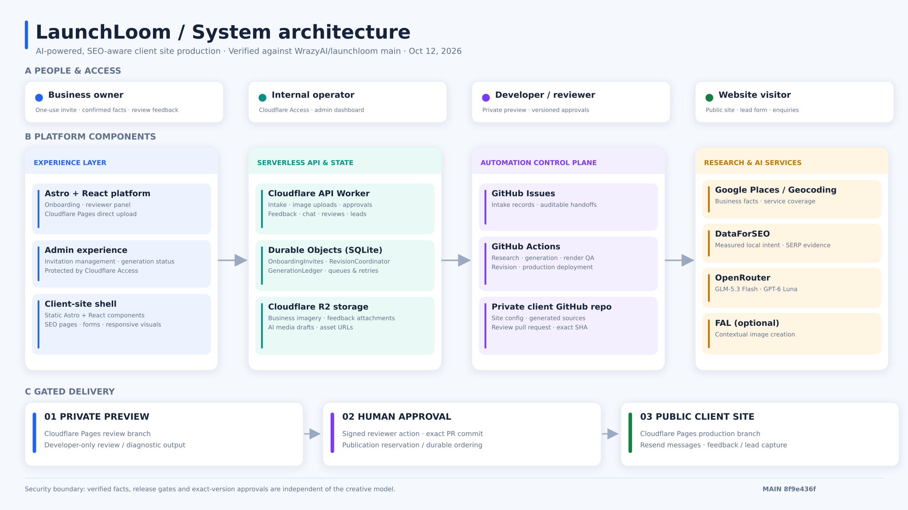
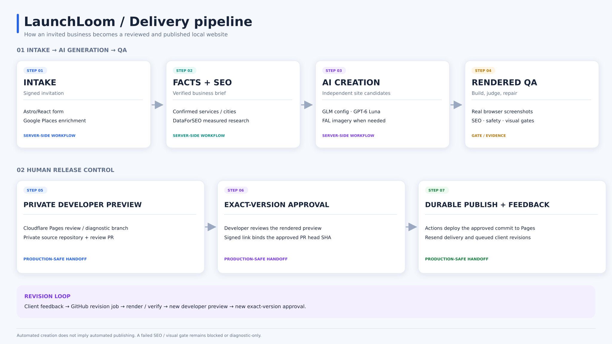

<p align="center">
  
</p>

<h1 align="center">LaunchLoom</h1>

<p align="center"><strong>From verified local-business facts to AI-generated, reviewed, production-ready websites.</strong></p>
<p align="center">Astro + React · Cloudflare · GitHub Actions · OpenRouter</p>

<p align="center">
  <a href="#architecture">Architecture</a> ·
  <a href="#how-a-site-ships">Delivery pipeline</a> ·
  <a href="#local-development">Local development</a> ·
  <a href="#configuration-and-deployment">Deployment</a> ·
  <a href="#further-reading">Documentation</a>
</p>

## Overview

LaunchLoom produces fast, SEO-aware **Astro websites for local businesses**. An invited client confirms their business facts, services, coverage and assets; a server-side pipeline conducts measured SEO research, compiles an authoritative brief, and asks AI models to author distinct website experiences. Automated source, browser and visual checks precede developer review. Only an **explicit approval of the exact reviewed Git commit** can publish the site.

The system deliberately separates three concerns:

- **Business truth:** Client-confirmed information, measured local research, asset provenance and approved page requirements.
- **Creative generation:** AI-authored copy, components, layouts and optional contextual imagery, constrained by the verified brief.
- **Release authority:** Quality gates, signed review links, private source control and durable, developer-approved publication.

There is no separately hosted backend server, external SQL database, Redis service or Cloudflare Git integration. The API runs on Cloudflare Workers; **SQLite-backed Durable Objects** persist invitation, revision, publication and generation-tracking state.

## Architecture



*Architecture snapshot: the Astro frontend and generated client sites are served from Cloudflare Pages; a Worker provides the API; Durable Objects coordinate state; R2 stores media; GitHub Actions orchestrates generation, QA and releases. [Open full-size diagram](docs/assets/launchloom-system-architecture.svg).*

| Layer | Main components | Role |
| --- | --- | --- |
| User experience | Astro, React, Cloudflare Pages | Invite-only onboarding, developer review and static client websites |
| API and state | Cloudflare Worker, Durable Objects (SQLite) | Intake, uploads, signed approvals, feedback, lead forms, queues and recovery |
| Media | Cloudflare R2 | Client photos/logos, review attachments and generated image assets |
| Automation | GitHub Actions, private per-client Git repositories | Research, authoring, build/test, preview, revision and publication |
| Research and AI | Google Places, DataForSEO, OpenRouter, optional FAL | Grounded business details, measured SEO, design/content authoring and images |
| Delivery and visibility | Cloudflare Pages Direct Upload, Resend, Sentry, generation ledger | Previews, live sites, lifecycle email, errors, run costs and status |

**Key boundary:** Cloudflare receives built static files through Pages Direct Upload, not access to client source repositories. Generated client source and review PRs live in **private WrazyAI repositories**.

## How a site ships



*The automated pipeline has reviewable checkpoints rather than a direct “prompt → production” path. [Open full-size diagram](docs/assets/launchloom-delivery-pipeline.svg).*

1. **Invite and intake:** An operator issues a signed, one-use link. The client confirms their business information, services and areas served; Google Places can suggest details, and files are uploaded to R2.
2. **Grounding and SEO:** Actions use confirmed facts plus DataForSEO research to build a canonical brief and site/page plan. Optional cited web-search fallback is **context only** and cannot substitute for the measured SEO evidence required to publish.
3. **Design and content:** A structured configuration lane uses GLM-5.3-Flash; a separate creative lane uses GPT-6 Luna by default to author independent, reference-informed Astro/React experiences. FAL can supply missing contextual imagery when enabled.
4. **Render and verify:** Candidates are built and rendered at desktop/mobile sizes. Factual/SEO, route, contrast, interaction, accessibility, reference-fidelity and visual-quality gates run; bounded repair attempts are rerendered and rechecked.
5. **Developer preview:** A passing candidate is deployed to a Pages review branch, associated with a private review PR, and emailed **only to the developer**. Failed candidates remain diagnostic evidence, not production releases.
6. **Approve and publish:** A signed approval reserves publication for the **reviewed PR head SHA**. The approval merges and GitHub Actions direct-uploads the verified commit to the site's production Pages branch.
7. **Feedback and revisions:** Client feedback queues scoped revisions and new developer previews. Durable coordination prevents overlapping publish/revision operations and supports idempotent recovery of uploads and notification emails.

A new Pages project starts with a neutral `noindex` preparation page to provision preview TLS. Generated client content is not published to its production hostname before developer approval.

## Repository map

| Path | Where to start |
| --- | --- |
| `src/pages/`, `src/components/` | Astro platform pages; React onboarding and review UI |
| `worker/src/index.ts` | Worker API routing, validation and external integrations |
| `worker/src/onboarding-invites.ts` | One-use invitation lifecycle and durable intake outbox |
| `worker/src/revision-coordinator.ts`, `publication.ts` | Ordered revision, approval, publication and recovery state |
| `worker/src/generation-ledger.ts` | Per-generation status, stage cost events and admin reporting |
| `templates/client-site/` | Independent Astro client-site shell, routes and shared runtime |
| `scripts/` | SEO research, config generation, reference selection, creative authoring, rendered QA and repair |
| `.github/workflows/` | Platform deployment, client generation, feedback processing and publishing |
| `docs/`, `tests/`, `worker/test/` | Architecture contracts, operational guides and test suites |

The main workflow entry points are [`generate-client.yml`](.github/workflows/generate-client.yml), [`process-feedback.yml`](.github/workflows/process-feedback.yml), [`process-client-feedback.yml`](.github/workflows/process-client-feedback.yml) and [`publish-site.yml`](.github/workflows/publish-site.yml).

## Local development

**Prerequisites:** Node.js 22, npm and Wrangler-compatible Cloudflare development credentials. Consult [`.env.example`](.env.example) for environment variable names. Keep local API credentials out of Git and configure local Worker secrets through Wrangler's supported local mechanism.

```bash
git clone https://github.com/WrazyAI/launchloom.git
cd launchloom
npm ci

# Platform, Worker and automated checks
npm run check
npm run check:worker
npm test
npm run test:worker
```

Start the API and frontend in **separate terminals**:

```bash
# Terminal 1 — local Worker API
npx wrangler dev
```

```bash
# Terminal 2 — Astro platform
PUBLIC_LAUNCHLOOM_API_URL=http://localhost:8787 npm run dev
```

The generated client-site template is independently installable and buildable:

```bash
cd templates/client-site
npm ci
npm run check
npm run build
```

**Before shipping:** Run relevant unit/Worker tests, the Astro check and production build; inspect generated desktop/mobile pages and verify routes, calls-to-action and forms. Follow [`AGENTS.md`](AGENTS.md) for the repository's contributor workflow and isolation conventions.

## Configuration and deployment

GitHub Actions is the production automation control plane; most deploy credentials are **repository secrets**, while origins, model selection and budget settings are **repository variables**. Never commit tokens or real client intake payloads.

| Category | Required settings / examples |
| --- | --- |
| Cloudflare | `CLOUDFLARE_API_TOKEN`, `CLOUDFLARE_ACCOUNT_ID`; Pages, Worker custom domain and R2 asset domain configured |
| GitHub automation | `LAUNCHLOOM_GITHUB_ORG_TOKEN` for private client repositories, issues, PRs and dispatches |
| AI and research | `OPENROUTER_API_KEY`, `GOOGLE_PLACES_API_KEY`; `DATAFORSEO_LOGIN` / `DATAFORSEO_PASSWORD` for measured local SEO |
| Signed flows | `ONBOARDING_INVITE_SIGNING_SECRET`, `REVIEW_SIGNING_SECRET`, `LEAD_SIGNING_SECRET`, `REVISION_COORDINATOR_SECRET` |
| Email | `RESEND_API_KEY`, `LAUNCHLOOM_FROM_EMAIL`, `LAUNCHLOOM_FEEDBACK_EMAIL`, `LAUNCHLOOM_DEVELOPER_EMAIL` |
| Operator Access | `ONBOARDING_ORIGIN`, `ONBOARDING_ADMIN_EMAILS`, `ONBOARDING_ACCESS_AUD` |
| Production Sentry | `PUBLIC_SENTRY_DSN`, `SENTRY_ORG`, `SENTRY_PROJECT`, `SENTRY_AUTH_TOKEN` |
| Optional features | `FAL_KEY` (contextual imagery), `GENERATION_TRACKING_SECRET` (ledger ingestion), `TURNSTILE_SECRET_KEY` (form challenge) |

The Worker is deployed to `api.launchloom.wrazyos.com`, client media uses `assets.launchloom.wrazyos.com`, and the invite-only page is at `launchloom-onboarding.pages.dev/onboard/`. Provider and model knobs (including `CREATIVE_EXPERIENCE_MODEL`, `FAL_IMAGE_MODEL` and SEO spend caps) are configured in [`generate-client.yml`](.github/workflows/generate-client.yml). Production creative defaults to `openai/gpt-6-luna`, with a frozen reasoning effort for the author/repair session; the structured site-config lane defaults to `z-ai/glm-5.3-flash`.

### Initial deployment and validation

1. Configure the Cloudflare Pages/R2 custom domains and required GitHub settings. Grant Cloudflare access to edit Workers, Pages and R2, and initial Workers Route / zone DNS permissions.
2. Configure the [Cloudflare Access application and signed invitations](docs/private-onboarding.md). The operator dashboard, invite management and generation ledger are protected by an allowlisted Access identity.
3. Run [**Deploy LaunchLoom platform**](.github/workflows/deploy-platform.yml), which builds the platform, directly uploads both Pages projects, installs Worker secrets and deploys the API Worker.
4. Validate the **fictional** end-to-end flow: invitation → upload → research → generation → developer preview → feedback → revision → exact-commit approval → production deployment → lead email. Keep existing Netlify sites live until their migration flows are verified.

**Important:** Pushing to `main` triggers platform deployment. Use a reviewed PR for changes; never treat an automated green build as proof of successful live client publication.

## Security and release rules

- **Access and token scope:** Operator endpoints require Cloudflare Access; review/approval and lead submissions use signed expiring claims and checked origins. Review submissions also bind to the invited email.
- **Abuse controls:** Forms have honeypots, bounded data sizes and Worker-side verification; optional Turnstile and Cloudflare WAF add protection. Lead and coverage lookup rate limits use durable state.
- **Fact integrity:** No invented business reviews, credentials, locations, guarantees or SEO metrics. A missing measured SEO map blocks new-site production approval even if contextual research succeeded.
- **Release safety:** Signed approvals reference the exact PR head; durable operation IDs, serialized publication/revisions, deployment readback and separate email retries support safe recovery.
- **Privacy action required:** The central `WrazyAI/launchloom` repository is currently public, and its intake API writes normalized submissions to GitHub Issues. **Do not submit real customer personal information until this storage/visibility path is made private and historical issue visibility is audited.** The generated client repositories are separate and private.

## Further reading

- [Private onboarding and Access](docs/private-onboarding.md) · [Creative compiler and visual QA](docs/creative-compiler.md)
- [SEO research and production readiness](docs/seo-research-mvp.md) · [Business facts contract](docs/business-facts-contract.md)
- [Ordered publishing and recovery](docs/publication-recovery.md) · [Generation tracking](docs/generation-tracking.md)
- [Site generation guidelines](docs/site-generation-guidelines.md) · [Local-business design direction](docs/local-business-design-direction.md)
- [Custom-domain handoff](docs/custom-domain-handoff.md) · [Deferred GHL integration](docs/ghl-integration.md)

The diagrams are a point-in-time architectural overview; the current workflows and runtime configuration are the implementation source of truth.
