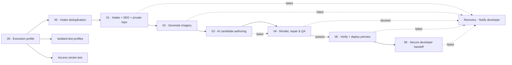

# GitHub Actions: visual client generation pipeline

The [Generate client site workflow](../.github/workflows/generate-client.yml) is now a real dependency graph, rather than a single long-running `generate` job. Each box in the Actions visualization represents work executed on its **own GitHub runner** and only starts when its upstream gate permits it.

## Stage responsibilities

| Job | Role | Durable output or gate |
| --- | --- | --- |
| `profile_policy` and `intake_handoff_check` | Route full vs. canary execution and avoid repeated developer delivery | Resolved execution profile and completed-handoff marker |
| `prepare` | Validate the intake, gather measured SEO evidence, compile canonical facts and reference DNA, create the private client repository and Pages project | Client `review/initial` branch, site config, SEO, inspiration and usage snapshots |
| `image_assets` | Generate or reuse independently reviewed contextual images | Generated images and asset report committed to private client repository |
| `creative_authoring` | Generate or validate independently authored candidate experiences | Candidate sources and frozen reasoning session committed to the private client repository |
| `rendered_quality` | Render real candidates, attempt bounded repairs, enforce creative fidelity and source validation | Creative-bakeoff report, final visual gate and recovery evidence committed privately |
| `private_preview` | Build the selected candidate again, enforce route/SEO/revision rules, upload a Pages review branch and record tracking | Verified preview URL and the exact build commit |
| `developer_handoff` | Issue a signed commit-bound developer review link, leave review context, email the developer, and mark intake delivery complete | Human review pending; no production publish without approval |
| `report_failure` | Send one alert for any blocked main stage | Developer alert and best-effort generation failure record |

`focused_test` remains a reusable test workflow, and `private_preview_access_smoke` remains an isolated access-only path.

### Checkpoint and safety rules

A fresh GitHub-hosted runner is allocated for each stage; `/tmp` and `$RUNNER_TEMP` do **not** carry over between jobs. The `scripts/restore-generation-stage.sh` helper clones the client's private `review/initial` branch, restores the stage input into a fresh runner, and refuses unrelated repository names. The workflow does not upload site configs, contact details, screenshots or generated code as public GitHub Actions artifacts.

Render recovery is intentionally triggered even if authoring fails. It attempts to preserve partial source evidence in the private repository, register the permitted repair path, and produce an Access-protected, noindex diagnostic preview where possible. It then leaves the Actions graph **red**; a recovery link is not a successful release.

A passed `rendered_quality` gate is required for the normal preview job. A passed preview is required before the handoff email and completion marker. The human approval and production release occur **later**, through [publish-site.yml](../.github/workflows/publish-site.yml); they cannot appear as future jobs inside the completed intake run without changing LaunchLoom's asynchronous approval model.

### Trade-offs

- Each stage performs a fresh checkout and `npm ci`. Render and preview jobs reinstall Chromium. This adds startup time but makes the Actions graph honest and lets the runner state be reclaimed after each phase.
- The client repository is now a stronger checkpoint boundary. Its generated/repair evidence can grow, so repository size and push latency should be monitored.
- Preview-only and candidate-reuse switches continue to operate through the existing input policy. They are *not* approval bypasses.
- Test the first full intake on fictional data before promoting this change, specifically comparing the resulting signed review SHA, recovery paths, and cost ledger against the original one-job workflow.

To inspect progress, open **Actions → Generate client site → specific run**. The visible jobs show the active or failed stage; select a box to see the step summary and its detailed logs.
